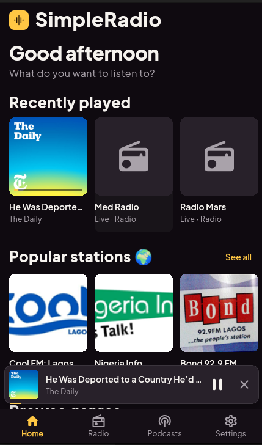
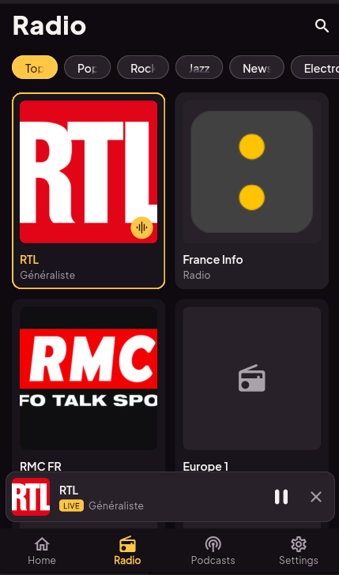
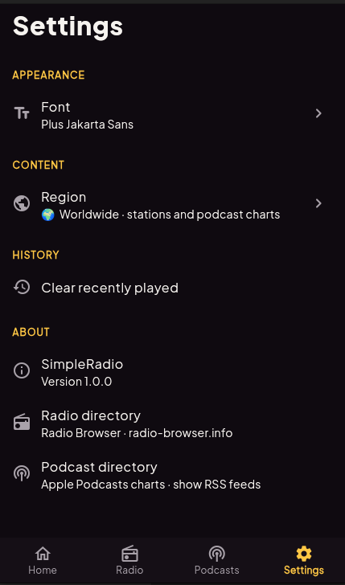

# SimpleRadio

Live radio and podcasts in one clean, dark Flutter app. Thousands of stations
from around the world, the top podcast charts, and a Spotify-style player that
keeps playing in the background. No account and no API keys needed.

<p align="center">
  
  
  
  
</p>

## Features

- **Live radio** from [Radio Browser](https://www.radio-browser.info): popular
  stations for your region, genre filters (Pop, Rock, Jazz, News…) and search.
- **Podcasts** from the Apple Podcasts charts and search, with episodes read
  straight from each show's RSS feed.
- **Now Playing page**: tap the mini player to open it.
  - Podcasts: draggable seek bar, 10-second skip back/forward, and playback
    speed from 0.75× to 2×.
  - Radio: a live badge and the song currently on air, when the station
    broadcasts it.
- **Resume where you left off**: podcast positions are saved as you listen,
  and progress shows on episode rows and on Home.
- **Background playback** with lock-screen and notification controls on
  Android, iOS, macOS and the web.
- **Home screen** with recently played items, popular stations, genre tiles
  and top podcasts.
- **Settings** for the font and your region.

The dark "Reelhouse" theme (plum background, amber accent, Instrument Sans and
Big Shoulders fonts) is shared with the streaming-site-next web project.

## Getting started

Requires the Flutter stable SDK (Dart 3.13 or newer).

```bash
flutter pub get
flutter run
```

### Linux

Audio on Linux plays through libmpv. Install it once:

```bash
sudo apt install libmpv2
```

Without it the app still opens, but pressing play shows how to install it.

### Platform notes

| Platform | Playback | Background & system controls |
| --- | --- | --- |
| Android | ✅ | ✅ notification, lock screen, headset |
| iOS | ✅ | ✅ lock screen, Control Center |
| macOS | ✅ | ✅ |
| Web | ✅ | ✅ browser media controls |
| Linux / Windows | ✅ via libmpv | ❌ |

The song-on-air display for radio isn't available on Linux and Windows.

Many stations still stream over plain `http://`, so cleartext traffic is
allowed on Android and iOS.

## Tech stack

| Area | Package |
| --- | --- |
| State management | [flutter_riverpod](https://pub.dev/packages/flutter_riverpod) |
| Audio | [just_audio](https://pub.dev/packages/just_audio), [audio_service](https://pub.dev/packages/audio_service), [just_audio_media_kit](https://pub.dev/packages/just_audio_media_kit) (Linux/Windows) |
| Networking | [dio](https://pub.dev/packages/dio) |
| RSS parsing | [xml](https://pub.dev/packages/xml) |
| Storage | [shared_preferences](https://pub.dev/packages/shared_preferences) |
| Fonts | [google_fonts](https://pub.dev/packages/google_fonts) |

## Project structure

Code is organized by feature:

```
lib/
├── main.dart                 App entry: preferences, audio setup, theme
├── app/                      Shell (bottom navigation, tabs) and theme
├── core/                     Networking, settings, tab navigation
├── common/                   Shared models, widgets and helpers
└── features/
    ├── home/                 Home tab
    ├── radio/                Radio Browser client, station grid, search
    ├── podcast/              Apple charts/search, RSS parser, episode list
    ├── player/               Audio engine, mini player, Now Playing page
    └── settings/             Settings tab
```

## Tests

```bash
flutter test
```

The tests use fake data sources, so they run offline.

## Data sources

- Radio stations: [Radio Browser](https://www.radio-browser.info), a free,
  community-run directory.
- Podcast charts and search: Apple Podcasts / iTunes Search API.
- Episodes: each podcast's public RSS feed.
